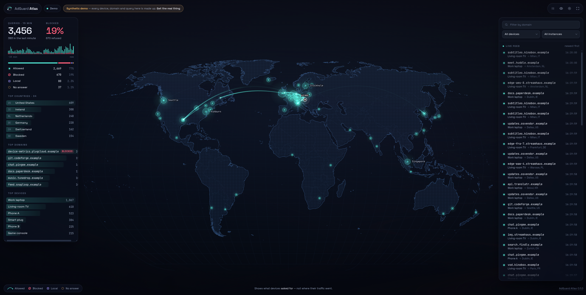

# AdGuard Atlas

A self-hosted world map of your network's DNS queries, live. It reads the query log
of one or more [AdGuard Home](https://github.com/AdguardTeam/AdGuardHome) instances
and draws an arc from your home to wherever each answer points.

One container, read-only use of AdGuard Home, no changes to your network.

> **It has no login of its own.** A DNS query log says who looked at what, and when.
> Run AdGuard Atlas on a network you trust, or behind a reverse proxy that
> authenticates. Do not publish its port to the internet.

> **It shows what devices asked for, not where traffic went.** Connections to a bare
> IP address, traffic volume and ports are invisible to it.

Not affiliated with AdGuard.

## Screenshot



Demo mode — every device, domain and query in the picture is generated.

## Try it in ten seconds (demo mode)

Demo mode invents a household — a TV, phones, a chatty smart plug — and generates
its traffic in your browser. No AdGuard Home is contacted and nothing needs
configuring.

```sh
docker build -t adguard-atlas .
docker run --rm -p 8080:8080 -e DEMO=true \
  --read-only --cap-drop ALL --security-opt no-new-privileges \
  adguard-atlas
```

Open <http://localhost:8080>.

## Run it against AdGuard Home

```sh
docker run -d --name adguard-atlas -p 8080:8080 \
  --read-only --cap-drop ALL --security-opt no-new-privileges \
  -e ADGUARD_1_URL=http://192.168.1.2:3000 \
  -e ADGUARD_1_USER=atlas \
  -e ADGUARD_1_PASSWORD='…' \
  -e HOME_LAT=52.23 -e HOME_LON=21.01 \
  adguard-atlas
```

Or use [`docker-compose.yml`](docker-compose.yml), the reference deployment: it
applies the same hardening and reads the password from a Docker secret.

```sh
mkdir -p secrets && printf '%s' 'the-password' > secrets/adguard_1_password
docker compose up -d
```

A second resolver is `ADGUARD_2_URL`, `ADGUARD_2_USER`, `ADGUARD_2_PASSWORD`, and so
on; all instances share one map and can be filtered apart.

If an instance cannot be reached or rejects the credentials, the page says so in
words (and the others keep working); `docker logs` says the same.

### The AdGuard Home account

AdGuard Home has no read-only role, so the account you give Atlas could also change
settings. Atlas only ever sends `GET /control/querylog` — a test pins that — and it
connects to the configured URLs and nowhere else. Credentials stay in the server;
the browser never sees them.

## Configuration

Environment variables only.

| Variable | Meaning | Default |
| --- | --- | --- |
| `ADGUARD_1_URL`, `ADGUARD_1_USER`, `ADGUARD_1_PASSWORD` | first instance | required |
| `ADGUARD_1_PASSWORD_FILE` | read the password from a file (Docker secrets) | — |
| `ADGUARD_1_NAME` | display name | host of the URL |
| `ADGUARD_1_INSECURE_TLS` | skip certificate verification for this instance | `false` |
| `ADGUARD_2_…` and so on | further instances | — |
| `HOME_LAT`, `HOME_LON` | where arcs start; never derived from your public IP | required |
| `HOME_LABEL` | label of the home marker | `Home` |
| `POLL_INTERVAL_MS` | polling period | `2000` |
| `WINDOW_MINUTES` | size of the in-memory window | `15` |
| `PRIVACY_MODE` | force masking of devices and domains | `false` |
| `IGNORE_CLIENTS` | comma-separated device names or IPs to leave out | empty |
| `IGNORE_DOMAINS` | comma-separated domains to leave out, subdomains included | empty |
| `DEMO` | synthetic traffic; `ADGUARD_*` and `HOME_*` are not required | `false` |
| `PORT` | listening port | `8080` |
| `GEOIP_DB` | path of the GeoIP database (`.mmdb`) | the bundled one |
| `LOG_LEVEL` | `debug`, `info`, `warn`, `error` | `info` |

Domains and device names are never logged at the default level; `LOG_LEVEL=debug`
prints them.

With `PRIVACY_MODE=true` the server replaces device names and domains before they
are stored or sent, so they never reach the browser at all. The privacy switch in
the page only hides them on screen.

## Using the page

| | |
| --- | --- |
| **Arcs** | allowed queries, from home to where the answer points |
| **Pulses at home** | blocked (solid ring), local (thin ring), no answer (broken ring) |
| **Markers** | grow with the number of queries in the window |
| **Click** a marker, a country, a feed line or a top-list row | the domains and devices behind it |
| **Class rows** in the counters | click to hide or show a class |
| **Wheel / pinch / drag** | zoom and pan; double-click resets |

| Key | |
| --- | --- |
| `Space` | pause or resume the animation (the feed keeps collecting) |
| `P` | privacy mode |
| `T` | dark / light theme |
| `K` | kiosk mode |
| `Esc` | close the detail panel, leave kiosk mode |

URL parameters: `?kiosk` (map and a caption only, for a wall display),
`?kiosk=bare` (map only), `?theme=light`, `?privacy`.

When more queries arrive than can sensibly be animated, arcs are capped at about
twelve per second: queries to the same place merge into one heavier arc, and the
rest only make their marker flash. Everything is still counted.

## How entries are classified

| Class | Meaning | On the map |
| --- | --- | --- |
| allowed | answered with a public address | arc home → destination |
| blocked | AdGuard Home's reason starts with `Filtered` | pulse at home |
| local | private address, or a rewrite that leads nowhere public | counted |
| no answer | NXDOMAIN, SERVFAIL, empty, or an answer without an address | counted |

The destination is the first public address among the `A`/`AAAA` records of the
answer, so a `CNAME` chain is followed to its end. Queries whose answer carries no
address at all (`TXT`, `MX`, most `HTTPS` records) land in "no answer".

## GeoIP

Locations come from a database inside the container; no lookup service is called.

The image bundles [DB-IP City Lite](https://db-ip.com/db/download/ip-to-city-lite)
(CC BY 4.0), downloaded when the image is built — it is not in this repository.
The build tries the current month's file, then the previous one, and fails with a
clear message if neither can be fetched. `--build-arg GEOIP_URL=…` overrides the
location; `--build-arg GEOIP=skip` builds without a database.

To use MaxMind GeoLite2-City instead (it needs a licence key and may not be
bundled), mount it and point `GEOIP_DB` at it:

```sh
docker run … -v /path/GeoLite2-City.mmdb:/data/GeoLite2-City.mmdb:ro \
  -e GEOIP_DB=/data/GeoLite2-City.mmdb adguard-atlas
```

A country-only database has no coordinates and cannot be used. GeoIP is an
estimate: a marker shows where the database believes an address is registered or
served from, and for anycast networks that can be far from the server that
actually answered you.

## Security

- No login (see the top of this page).
- Outbound connections: the configured AdGuard Home URLs only. Redirects are not followed.
- The page loads nothing from anywhere else — no tiles, fonts, or analytics — and
  says so with a Content-Security-Policy (`default-src 'none'`, `connect-src 'self'`).
  The static demo uses `connect-src 'none'`.
- Nothing is written to disk. A restart loses the window and nothing else.
- Container: non-root (uid 10001), read-only root filesystem, all capabilities
  dropped, `no-new-privileges`, healthcheck on `/healthz`. No tmpfs is needed.

## Development

Everything runs in Docker; nothing needs installing on the host.

```sh
# type check, lint, tests
docker build --target check .

# the runtime image
docker build -t adguard-atlas .

# the static demo: plain files, no server component, for any static host
docker build --target demo -o demo-dist .
```

The static demo is what `npm run build:demo` produces (`dist/demo`). It includes a
`_headers` file for Cloudflare Pages and carries its policy in a `<meta>` tag as
well. It has to be served over HTTP by any static file server; browsers do not load
module scripts from `file://`.

Layout: `src/server` (polling, classification, GeoIP, event stream), `src/web`
(React shell, canvas map, in-browser demo generator), `src/shared` (the event type
both sides speak), `test` (including a fake AdGuard Home and recorded query-log
fixtures). The specification is in [docs/SPEC.md](docs/SPEC.md).

## Credits and licence

GNU General Public License v3.0 — see [LICENSE](LICENSE).

IP geolocation by [DB-IP](https://db-ip.com). World geometry from
[Natural Earth](https://www.naturalearthdata.com/). Fonts: Space Grotesk and
JetBrains Mono (SIL OFL). Details in [NOTICE.md](NOTICE.md).
